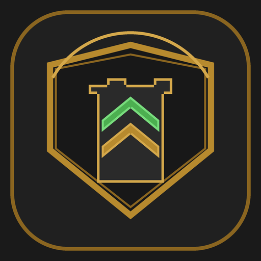

# Clash Command

<p align="center">
  
  <br>
  <strong>Offline-first Clash of Clans upgrade & builder tracker for Android</strong>
</p>

<!--
SEO description: Clash Command is an offline-first Flutter Android app for tracking Clash of Clans upgrade timers, managing multiple villages, monitoring builder availability, and scheduling local reminders.
Keywords: Clash Command, Clash of Clans timer tracker, Flutter Android app, offline upgrade assistant, village timer manager, local SQLite app, APK build guide, Drift SQLite, Riverpod
-->

Clash Command is an Android-first, offline-first Flutter application designed to track Clash of Clans upgrades, monitor builder availability, and schedule local completion reminders. It is intentionally local-first, privacy-friendly, and lightweight—operating with zero cloud dependencies, user accounts, or external backends.

---

## Features

- **Multi-Village Management**: Create and switch between multiple villages, customize Town Hall levels (supports up to Town Hall 18 with an extensible architecture for future releases), notes, and builder capacities (1–6 builders).
- **Four Upgrade Categories & Facilities**: Dedicated tracking for **Home Village — Builder**, **Home Village — Laboratory**, **Builder Base — Builder**, and **Builder Base — Star Laboratory**.
- **Upgrade Name Autocomplete & Local Catalogue**: Built-in, verified catalogue of buildings, troops, heroes, spells, and defenses with instant case-insensitive search and level suggestions. Fully customizable with local user suggestion persistence.
- **Optional From Level & To Level Tracking**: Track upgrade progressions clearly (e.g. `Archer Tower · Lv. 18 → 19`) with intelligent auto-suggestion and level validation.
- **Upgrade Tracking & Timing**: Accurate countdown timers computed from absolute UTC timestamps with live second-by-second countdown when under 5 minutes remain. Supports custom remaining durations and builder slot assignment.
- **Inspect & Edit Upgrades**: Tap any active upgrade to view progress, start time, expected completion, levels, notes, and quick actions (Complete, Edit, Cancel, Delete).
- **Activity History & Audit Trail**: Full event logging of village modifications and upgrade status transitions stored in local SQLite, filterable by village and event type.
- **Native Android Home-Screen Widgets**: Glanceable **Upgrade Overview** and **Builder Status** widgets for your Android home screen displaying active countdowns, progress, and free builder availability.
- **Local Completion Reminders**: Configurable local notifications for upgrade completion and upcoming warnings (60m, 30m, 10m, 5m, 1m) with in-app permission checks and diagnostic metrics.
- **Modern Dark UI**: Material 3 dark-themed interface built for tactical focus.
- **Offline & Private**: All data is stored locally in an embedded SQLite database using Drift. No tracking, no analytics, no external network calls.

---

## Tech Stack

- **Framework**: [Flutter](https://flutter.dev) (Dart 3.x)
- **State Management**: [Riverpod](https://riverpod.dev)
- **Local Persistence**: [Drift](https://drift.simonbinder.eu/) (SQLite) with automated schema migrations
- **Local Notifications**: `flutter_local_notifications` (Android notification channels & timezone scheduling)
- **Home Screen Widgets**: Native Android AppWidgets powered by `home_widget`
- **Design System**: Material 3 Dark Theme with custom branding and adaptive launcher icons

---

## Repository Structure

```
├── android/                 # Android native project, adaptive icons, Gradle configuration
├── assets/                  # Branding assets (emblem, transparent badges)
├── docs/                    # Architecture guides, release workflow, and technical docs
│   ├── releases.md          # Versioning strategy, APK build, and release checklist
│   ├── architecture.md      # Full architecture specification
│   ├── prod.md              # Production specifications & data model
│   └── agent.md             # Development agent instructions
├── lib/                     # Flutter application source code
│   ├── core/                # Colors, themes, and shared utilities
│   ├── database/            # Drift SQLite database, tables, and DAOs
│   ├── features/            # Feature modules (dashboard, villages, upgrades, history, settings)
│   └── main.dart            # Application entry point
├── scripts/                 # Asset generation scripts (Pillow-based branding)
├── test/                    # Unit, DAO, service, and widget test suite
├── CHANGELOG.md             # Version history adhering to Keep a Changelog
├── Makefile                 # Convenient build and run targets
└── pubspec.yaml             # Dependencies and app metadata (v1.0.3+4)
```

---

## Prerequisites

- **Flutter SDK**: 3.24+ (Dart 3.5+)
- **Android SDK**: API 34+ (with Build-Tools 34.0.0+)
- **Java**: JDK 17
- Android device or emulator running Android 8.0+ (API 26+)

Set up your Android environment (Linux/macOS):

```bash
export ANDROID_HOME="$HOME/android-sdk"
export ANDROID_SDK_ROOT="$HOME/android-sdk"
export PATH="$HOME/flutter/bin:$ANDROID_HOME/platform-tools:$ANDROID_HOME/cmdline-tools/latest/bin:$PATH"
flutter doctor
```

---

## Quick Start

### 1. Clone & Install Dependencies

```bash
git clone https://github.com/AmruthLP12/clash-command.git
cd clash-command
flutter pub get
```

### 2. Run on a Connected Android Device or Emulator

```bash
flutter devices
flutter run
```

### 3. Run on Web / Chrome (Optional)

```bash
# In Google Chrome
make run-chrome-port PORT=8081

# Or as a local network web server
make run-web-ip PORT=8080
```

---

## Building Android APKs

### Debug APK (For Testing)

```bash
make build-apk-debug
# Output: build/app/outputs/flutter-apk/app-debug.apk
```

### Release APK (Optimized & Tree-Shaken)

```bash
make build-apk-release
# Output: build/app/outputs/flutter-apk/app-release.apk
```

### Release Signing Setup

By default, release builds compile with debug keys so testers can immediately install them. To sign with a production key:

1. Generate your release keystore:
   ```bash
   keytool -genkey -v -keystore android/upload-keystore.jks -keyalg RSA -keysize 2048 -validity 10000 -alias clashcommand
   ```
2. Create `android/key.properties` (ignored by git):
   ```properties
   storePassword=YOUR_STORE_PASSWORD
   keyPassword=YOUR_KEY_PASSWORD
   keyAlias=clashcommand
   storeFile=../upload-keystore.jks
   ```
3. Run `make build-apk-release`.

See [docs/releases.md](docs/releases.md) for full release, versioning, and distribution details.

---

## Branding & Asset Generation

Master brand emblems and multi-density Android launcher icons (legacy and adaptive mipmaps) can be regenerated reproducibly:

```bash
make branding
# Or: python3 scripts/generate_branding_assets.py
```

---

## Testing & Quality Assurance

Run the test suite and static analysis:

```bash
# Run static analysis
make analyze
# flutter analyze

# Run all unit, service, and widget tests
make test
# flutter test
```

---

## Useful Makefile Commands

| Command | Description |
| :--- | :--- |
| `make help` | Display available commands |
| `make test` | Run all automated tests |
| `make analyze` | Run static Dart analysis |
| `make build-apk-debug` | Build unoptimized debug APK |
| `make build-apk-release` | Build AOT-compiled release APK |
| `make build-appbundle` | Build Android App Bundle (`.aab`) |
| `make branding` | Regenerate logo and adaptive Android icons |
| `make clean` | Clean Flutter build cache and generated files |

---

## Documentation Links

- [Release & Versioning Guide](docs/releases.md)
- [Changelog](CHANGELOG.md)
- [Architecture Details](docs/architecture.md)
- [Product Specifications](docs/prod.md)
- [Development Guide](docs/development-guide.md)

---

## License

Personal and community project. Not affiliated with, endorsed, sponsored, or specifically approved by Supercell.
