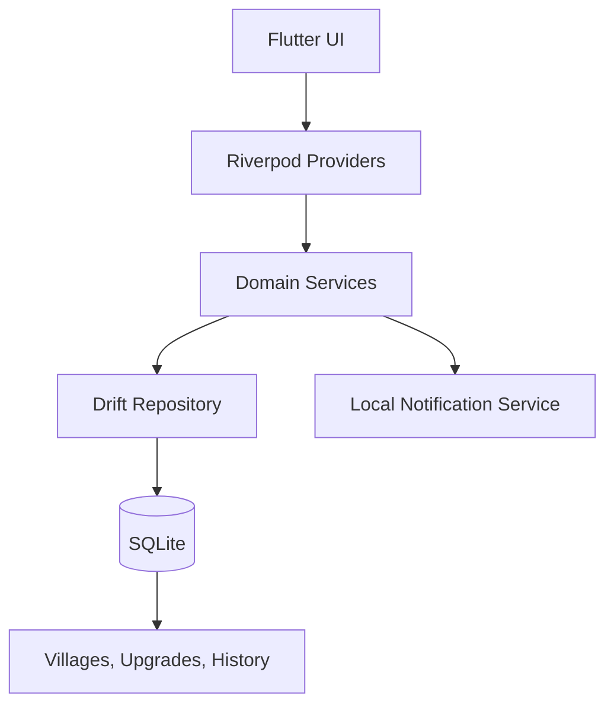

# Clash Command Development Guide

This document is the practical implementation guide for building the Clash Command app as a personal, offline-first Clash of Clans builder tracker.

The goal is simple: keep the app local, fast, privacy-friendly, and reliable. No backend, no cloud sync, no website, and no background job framework are required for the initial version.

## 1. Product direction

Clash Command is a personal Android app for tracking:

- village progress
- active upgrades
- builder availability
- completion times
- reminder notifications
- upgrade history and planning

The app is designed for a single user who wants a local, manual, dependable tracker without any external service or account.

### Core constraints

- Android-first Flutter app
- Offline-only by default
- Local storage only
- No game automation or account integration
- No backend, server, Docker, or cloud layer in v1
- No hidden tracking or analytics
- Manual entry and local reminders only

---

## 2. Recommended tech stack

### Flutter + Dart

Use Flutter and Dart for the mobile app UI and logic.

Why this fits:

- fast Android app development
- easy local state management
- good tooling and testing support
- future cross-platform flexibility

### SQLite + Drift

Use Drift over SQLite as the local database layer.

Why this fits:

- reliable offline storage
- direct support for local village and upgrade data
- clear model and DAO structure
- good fit for an app whose source of truth is local data

### Riverpod

Use Riverpod for state and dependency access.

Why this fits:

- predictable state handling
- cleaner separation between UI and logic
- easy testing of app state and providers

### Local notifications

Use Flutter local notifications for reminders and completion alerts.

Why this fits:

- no backend needed
- the app can remind the user even when the app is not open
- works well for upgrade completion and scheduled alerts

---

## 3. Recommended development strategy

Build the app in phases so it stays manageable and avoids over-engineering.

### Phase 1 — Core app

This phase should deliver the minimum useful product.

Features:

- create, edit, and delete villages
- set Town Hall level and builder count
- add villages and upgrade records manually
- start an upgrade with a name and duration
- see live countdowns and completion times
- schedule reminder notifications
- store everything locally

This is the foundation. If the app can do this well, it is already valuable.

### Phase 2 — Better tracking

Add features for better daily use.

Features:

- categories such as building, troop, hero, laboratory, defense, and other
- custom reminder intervals
- upgrade history
- filtered view across villages
- sorting and search for active upgrades
- summary cards for next completion and active counts

### Phase 3 — Quality of life

Only after the core flows are working well.

Features:

- backup and restore
- export/import of local data
- advanced planning views
- optional app widgets or home-screen shortcuts
- deeper local UX polish
- possible future integration with official data sources if allowed

---

## 4. App architecture

The app should follow a clean local-first architecture.



### Responsibilities

#### UI layer

- screens
- forms
- cards and lists
- user actions
- display of countdowns and statuses

#### Domain layer

- upgrade timer calculations
- completion detection
- overdue logic
- validation rules
- village summary logic

#### Data layer

- Drift schema
- database tables
- repository access
- local CRUD operations

#### Notification layer

- schedule reminders
- reschedule when the app starts
- reconcile notifications after reboot or restarts
- ignore permission issues gracefully

Important rule:

- the database is the source of truth
- UI widgets do not issue SQL directly
- timer and lifecycle logic must be testable outside the UI

---

## 5. Data model

The app should be built around a small but solid set of local records.

### Village

Fields:

- id
- name
- townHallLevel
- builderCapacity
- createdAtUtc
- updatedAtUtc
- isArchived
- optional notes

### Upgrade

Fields:

- id
- villageId
- name
- category
- slotKey or builder reference if needed
- startedAtUtc
- expectedCompletionAtUtc
- status: active, completed, cancelled
- completedAtUtc
- notes
- createdAtUtc
- updatedAtUtc

### Catalog item

Optional but useful for future local upgrade metadata.

Fields:

- id
- name
- category
- townHall hint
- durationSeconds
- source metadata if bundled locally

### Notification preferences

Minimum settings:

- reminders enabled
- reminder offsets
- quiet hours if added later

---

## 6. Timer rules

This is one of the most important parts of the app.

### Required rule

Store absolute timestamps and compute remaining time from the current clock.

Do not do this:

- do not decrement a stored remaining-seconds counter in the database
- do not persist a countdown as mutable state

Do this instead:

- keep the end time as an absolute timestamp
- compute remaining time as:

  expectedCompletionAtUtc - current time

### Timer behaviors

- if a timer is active and already past due, show it as past due or ready
- do not silently mark it completed unless the user explicitly finishes it
- if the user edits a timer, update the expected completion timestamp
- invalidate old notification plans when the timer changes
- do not schedule notifications in the past

---

## 7. Notification behavior

Local notifications should be simple and reliable.

Requirements:

- schedule completion reminder on active upgrades
- optionally schedule earlier reminder offsets
- reconcile scheduled notifications on app launch
- reconcile again after device restart where supported
- if permission is denied, continue tracking without blocking the app

Notification logic must stay in a dedicated service instead of being embedded in the UI.

---

## 8. Recommended project structure

A clean structure for this project is:

```text
lib/
  app/
    theme/
  core/
    datetime/
    utils/
  data/
    local/
      drift/
      repositories/
  domain/
    models/
    services/
  features/
    villages/
    upgrades/
    notifications/
    settings/
  main.dart
```

This is enough structure to stay organized without creating unnecessary abstraction layers.

---

## 9. Step-by-step build plan

### Step 1: initialize the project

Create the Flutter project and verify the environment.

Required checks:

- Flutter SDK is installed
- Java 17+ is available
- Android SDK is configured
- Android emulator or device is available
- Flutter doctor is clean

Use commands like:

```bash
flutter doctor
flutter devices
flutter create .
```

---

### Step 2: set up the local app shell

Build a clean Material 3 app with dark theme and a dashboard shell.

Goal:

- app opens successfully
- basic navigation exists
- UI is ready for village and upgrade cards

---

### Step 3: implement domain models and logic

Create plain Dart models and services for:

- Village
- Upgrade
- UpgradeStatus
- UpgradeTimerService
- VillageService

Focus on:

- remaining time
- overdue checks
- completion checks
- summary logic for active upgrades

Write unit tests early.

---

### Step 4: add the local database layer

Add Drift and define tables for:

- village table
- upgrade table
- notification preference table
- history or archive data if needed

Rules:

- keep the database as the source of truth
- create repositories around the database access
- avoid direct SQL in widgets

---

### Step 5: build the village flow

Implement the village management flow:

- add village
- rename village
- set Town Hall level
- set builder capacity
- archive or delete village if allowed

Show village cards with active counts and next completion.

---

### Step 6: build the upgrade flow

Implement:

- create upgrade entry
- assign to village
- set category and duration
- calculate expected completion time
- mark as active, completed, or cancelled
- show countdown in the UI

---

### Step 7: add notification scheduling

Add the local notifications service and tie it to the upgrade lifecycle.

Schedule and reconcile:

- completion notification
- reminder notification offsets
- notification cancellation on deletion or completion

---

### Step 8: add history and active states

Build a list or history screen for:

- completed upgrades
- cancelled upgrades
- active upgrades
- filters by date or category

This gives the app useful long-term tracking value.

---

### Step 9: test and validate

At minimum, test:

- timer calculations
- overdue behavior
- completion logic
- village summary logic
- widget rendering for the main dashboard

Commands:

```bash
flutter test
flutter analyze
```

---

### Step 10: build APK for Android distribution

After the app is stable, build the APK.

Debug build:

```bash
flutter build apk --debug
```

Release build:

```bash
flutter build apk --release
```

Play Store bundle:

```bash
flutter build appbundle --release
```

---

## 10. Development principles to keep the project healthy

- keep the app local-first
- prefer manual control over automation
- store all important state locally
- use absolute timestamps, not countdown counters
- keep business logic separate from UI logic
- make timer logic testable without Flutter widgets
- avoid adding packages unless they clearly solve a requirement
- keep notifications non-blocking if permissions fail

---

## 11. Minimum milestone checklist

The app is ready to move to the next stage when these are true:

- app launches cleanly on Android
- village creation works
- upgrade records can be added
- countdowns update from the current timestamp
- app survives restart without losing tracked data
- notifications are rescheduled when needed
- tests cover the timer rules
- project builds without analyzer issues

---

## 12. Suggested next tasks for this project

The immediate priority list should be:

1. add village and upgrade models
2. add timer and summary services
3. add Drift database schema
4. add repository layer for villages and upgrades
5. create dashboard and active upgrade list
6. add notification scheduling and reconciliation
7. add filters, history, and polish
8. build APK and validate the release flow

---

## 13. Final recommendation

Since this is a personal builder tracker, the best first version is a completely offline Android app built with Flutter, Drift, Riverpod, and local notifications.

This keeps the app:

- private
- fast
- dependable
- easy to maintain
- focused on real utility, not cloud complexity

That is the correct starting point for this project.
